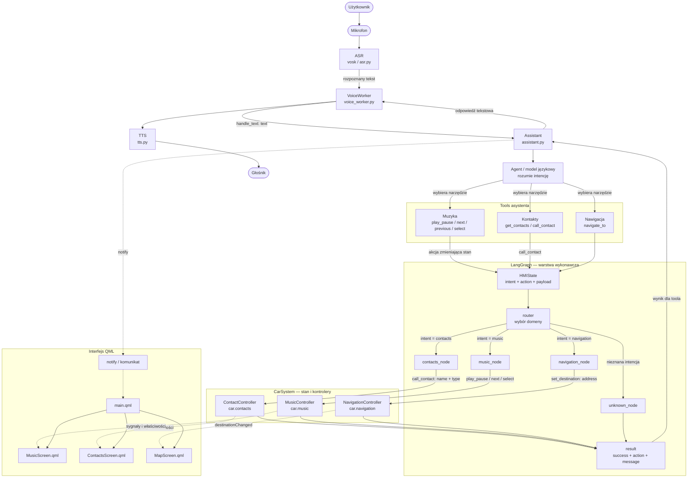

# Architektura aplikacji — diagram przepływu

Ten diagram pokazuje pełny przepływ polecenia głosowego od mikrofonu do
kontrolera samochodu i z powrotem do użytkownika.



## Jak czytać diagram?

### 1. Wejście głosowe

Użytkownik mówi do mikrofonu. `ASR` zamienia mowę na tekst. `VoiceWorker`
przekazuje tekst do `Assistant`.

### 2. Rozumienie polecenia

`Assistant` przekazuje tekst do agenta językowego. Agent nie steruje
bezpośrednio kontrolerami. Wybiera odpowiedni tool i przekazuje mu argumenty.

Przykład:

```python
call_contact(
    name="Anna Kowalska",
    number_type="work",
)
```

### 3. Przekazanie akcji do grafu

Tool zamienia wywołanie na stan grafu:

```python
{
    "intent": "contacts",
    "action": "call_contact",
    "payload": {
        "name": "Anna Kowalska",
        "number_type": "work",
    },
}
```

Znaczenie pól:

- `intent` — domena, na przykład `contacts` albo `music`;
- `action` — konkretna operacja;
- `payload` — argumenty operacji;
- `result` — wynik po wykonaniu node’a.

### 4. Routing

`router` patrzy na `intent` i wybiera jeden node:

```text
contacts   → contacts_node
music      → music_node
navigation → navigation_node
inne       → unknown_node
```

### 5. Wykonanie akcji

Node wywołuje metodę właściwego kontrolera:

```text
contacts_node   → car.contacts.call_contact()
music_node      → car.music.play_pause()
navigation_node → car.navigation.set_destination()
```

Logika domenowa pozostaje w kontrolerach `CarSystem`, a nie w routerze i nie w
modelu językowym.

### 6. Wynik i odpowiedź

Node zwraca ujednolicony wynik:

```python
{
    "success": True,
    "action": "call_contact",
}
```

`Assistant` wykorzystuje wynik do przygotowania komunikatu. `VoiceWorker`
przekazuje go do TTS, a TTS wypowiada go użytkownikowi.

## Osobna ścieżka QML

Kontrolery mogą równolegle emitować sygnały i aktualizować właściwości QML.
Dlatego ekran nie musi czekać na odpowiedź głosową:

```text
MusicController      → MusicScreen.qml
ContactController    → ContactsScreen.qml
NavigationController → MapScreen.qml
```

Przykładowo `set_destination()` może zmienić właściwość `destination`, a
`MapScreen.qml` zareaguje na zmianę i pokaże nowy cel.

## Najważniejszy podział odpowiedzialności

```text
ASR:
    zamienia mowę na tekst

Assistant / agent:
    rozumie język i wybiera tool

Tool:
    mapuje argumenty na intent, action i payload

Graph:
    wybiera node i prowadzi wykonanie

Node:
    wywołuje właściwy kontroler

Controller:
    zmienia stan aplikacji

QML:
    pokazuje stan i reaguje na sygnały

TTS:
    zamienia odpowiedź na mowę
```

## Ważna zasada dla kontaktów

Jeśli kontakt ma dwa numery, agent nie powinien wywoływać obu wariantów.
Najpierw musi zapytać użytkownika o typ numeru:

```text
Użytkownik: Zadzwoń do Anny.
Agent:     Czy wybrać numer mobilny czy służbowy?
Użytkownik: Służbowy.
Agent:     call_contact(name="Anna Kowalska", number_type="work")
```

`call_contact` powinien zostać wywołany dokładnie raz po uzyskaniu kompletnego
`payload`.

