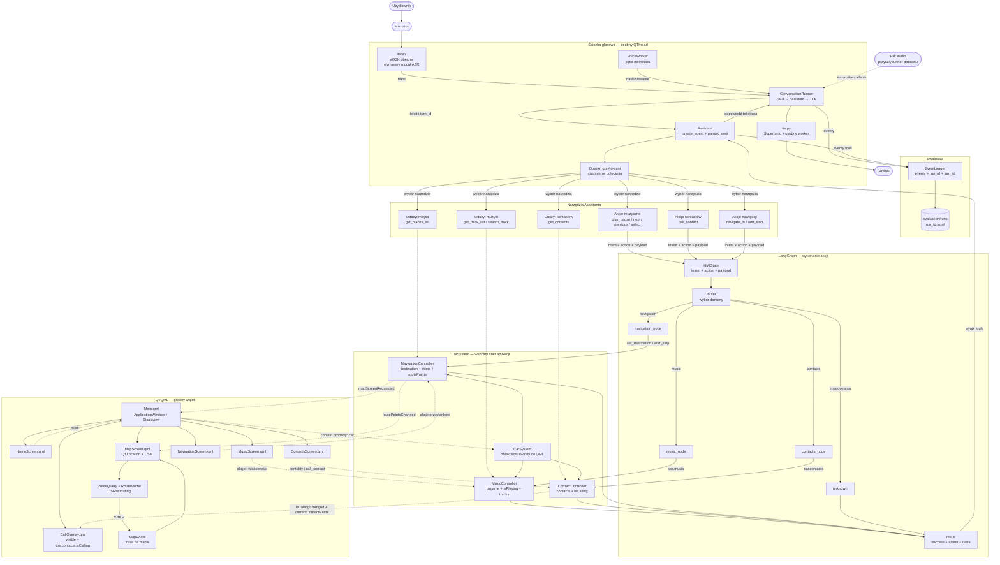

# Architektura aplikacji — pełny przepływ

Diagram pokazuje aktualną architekturę aplikacji: dwa sposoby sterowania
samochodem (głos i dotyk), wspólny `CarSystem`, wykonanie akcji przez
LangGraph, aktualizację interfejsu QML oraz rejestrowanie sesji badawczej.



## Główne ścieżki

### 1. Polecenie głosowe

```text
mikrofon
  ↓
asr.py (VOSK; moduł wymienny)
  ↓ tekst
VoiceWorker
  ↓ listen(stop_event)
ConversationRunner
  ↓ handle_text(turn_id)
Assistant + model językowy
  ↓ wybór toola
LangGraph (dla akcji zmieniających stan)
  ↓
CarSystem / kontroler
  ↓ wynik
Assistant
  ↓
TTS → głośnik
```

`VoiceWorker` działa w osobnym `QThread`, a interfejs Qt/QML pozostaje w
głównym wątku. `ConversationRunner` wykonuje każdą turę niezależnie od źródła
audio: `VoiceWorker` przekazuje mu mikrofon, a przyszły runner datasetu poda
funkcję ASR dla pliku. `EventLogger` zapisuje eventy do
`evaluation/runs/<run_id>.jsonl`. Moduł ASR jest odseparowany od Assistanta:
jego odpowiedzialność kończy się na zwróceniu tekstu.

### 2. Narzędzia Assistanta

Narzędzia odczytujące dane pobierają stan bezpośrednio z kontrolera:

```text
get_track_list()  → car.music.tracks
search_track()    → car.music.tracks
get_contacts()    → car.contacts.contacts
get_places_list() → car.navigation.places_list
```

Narzędzia wykonujące akcje przechodzą przez graph:

```text
play_pause / next_track / previous_track / select_track
call_contact
navigate_to / add_stop
        ↓
graph.invoke({intent, action, payload})
```

### 3. LangGraph

```text
START
  ↓
router
  ├── music      → music_node      → car.music
  ├── contacts   → contacts_node   → car.contacts
  ├── navigation → navigation_node → car.navigation
  └── unknown    → wynik błędu
  ↓
END
```

Stan wejściowy akcji ma postać:

```python
{
    "intent": "navigation",
    "action": "add_stop",
    "payload": {
        "address": "ul. Stacyjna 10, Szczecin",
    },
}
```

Node zwraca wynik do Assistanta:

```python
{
    "result": {
        "success": True,
        "action": "add_stop",
        "stop": "ul. Stacyjna 10, Szczecin",
    },
}
```

### 4. Nawigacja i mapa

`NavigationController` przechowuje stały punkt startowy, cel oraz listę
przystanków. Każdy adres jest wyszukiwany w testowej bazie miejsc i ma własne
współrzędne.

```text
start → stop 1 → stop 2 → destination
                 ↓
        routePointsChanged
                 ↓
MapScreen.qml
                 ↓
RouteQuery + RouteModel
                 ↓
OSM / OSRM
                 ↓
MapRoute na mapie
```

Cel można ustawić głosem przez `navigate_to(street, city, number)`, a
przystanek dodać głosem przez `add_stop(street, city, number)` albo dotykiem
w `MapScreen.qml`, wpisując dokładny adres testowy. Zmiana celu emituje także
`mapScreenRequested`, dzięki czemu `Main.qml` otwiera ekran mapy.

### 5. Sterowanie dotykowe i CallOverlay

`Main.qml` zarządza ekranami przez `StackView`:

```text
HomeScreen
  ├── MusicScreen
  ├── ContactsScreen
  ├── NavigationScreen
  └── MapScreen
```

`CallOverlay.qml` jest dzieckiem `ApplicationWindow`, a nie konkretnego
ekranu. Dlatego pozostaje widoczny podczas przechodzenia między ekranami,
dopóki `car.contacts.isCalling` ma wartość `true`. Przycisk rozłączenia
wywołuje `car.contacts.end_call()`, zmienia stan na `false` i ukrywa overlay.

Kontrolery emitują sygnały i udostępniają właściwości QML:

```text
MusicController      → MusicScreen.qml
ContactController    → ContactsScreen.qml + CallOverlay.qml
NavigationController → MapScreen.qml
```

## Podział odpowiedzialności

```text
ASR:
    zamienia mowę na tekst

VoiceWorker:
    przekazuje mikrofon do ConversationRunner w pętli głosowej

ConversationRunner:
    wykonuje ASR, Assistanta i TTS dla jednej tury

EventLogger:
    zapisuje eventy tury do pliku JSONL

Assistant / model:
    rozumie polecenie i wybiera narzędzie

Tool:
    odczytuje stan albo tworzy intent, action i payload

Graph:
    wybiera domenę i uruchamia właściwy node

Node:
    wywołuje kontroler

Controller:
    przechowuje stan i wykonuje operację

QML:
    pokazuje stan i obsługuje sterowanie dotykowe

TTS:
    zamienia odpowiedź Assistanta na mowę
```

## Wielowątkowość

```text
główny wątek Qt:
    QApplication + QML + CarSystem + kontrolery

osobny QThread:
    VoiceWorker + mikrofon + Assistant

osobny daemon Thread:
    tts.py worker + synteza i odtwarzanie audio
```

Metody kontrolerów, które mogą zostać wywołane z wątku Assistanta, przekazują
zmianę stanu do właściwego wątku Qt przez `QMetaObject.invokeMethod` i
`QueuedConnection`.

## Obecny stan ASR

Aktualnie `asr.py` korzysta z VOSK. Interfejs aplikacji został rozdzielony tak,
aby późniejsza podmiana na Whisper wymagała zmiany modułu ASR, a nie graphu,
kontrolerów ani ekranów QML.
