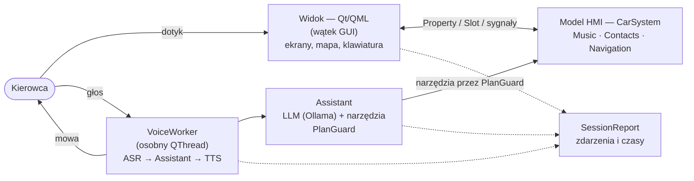
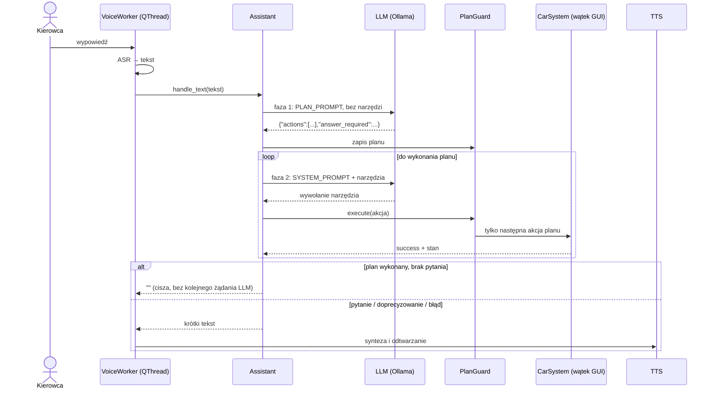

# Architektura prototypu

Dokument opisuje stan kodu (wersja `v1.0-thesis`). Jest bazą rozdziałów 3–4 pracy;
nie zawiera wyników — te są w analizach serii pomiarowych.

## 1. Warstwy

| Warstwa | Pliki | Odpowiedzialność |
| --- | --- | --- |
| Model HMI | `CarSystem/` | Jedyny stan aplikacji. Ten sam obiekt obsługuje dotyk i głos, więc obie modalności działają na identycznych operacjach (WF-01–06). |
| Widok | `Main.qml`, `qml/` | Ekrany Home, Muzyka, Kontakty, Nawigacja, Mapa; wiązania do właściwości kontrolerów. |
| Ścieżka głosowa | `voice_worker.py`, `asr/`, `tts.py` | Pętla tur w osobnym wątku; GUI nie jest blokowane (WNF-01). |
| Agent | `assistant/` | Zamiana wypowiedzi na operacje HMI z użyciem lokalnego LLM. |
| Pomiar | `session_report.py`, `session_callbacks.py`, `shutdown.py` | Zdarzenia z czasami, raport TXT/JSON, stan końcowy. |
| Eksperyment | `experiments/` | Seria 108 prób w osobnych procesach i kryterium sukcesu. |

Wszystko działa lokalnie (WNF-02): Vosk/whisper.cpp, Ollama pod `127.0.0.1:11434`
(bez proxy i bez fallbacku do chmury), Supertonic; tracing LangSmith jest wyłączony.

## 2. Model HMI i współbieżność

`CarSystem` udostępnia trzy kontrolery jako właściwości Qt. Każdy kontroler jest
`QObject` żyjącym w wątku GUI; QML czyta jego właściwości i wywołuje sloty.

Agent działa w wątku `VoiceWorker`. Metody zmieniające stan są oznaczone dekoratorem
`@on_gui_thread` (`CarSystem/gui_thread.py`): wywołanie z innego wątku jest
przekazywane do wątku GUI blokującym sygnałem kolejkowym, a wywołujący dostaje
rzeczywisty wynik (`True`/`False`) albo wyjątek. Dzięki temu agent wie, czy operacja
się udała, a QML nigdy nie widzi stanu zmienianego z obcego wątku.

- **Muzyka** — biblioteka 3 plików, odtwarzanie przez pygame. `set_playback(bool)`
  ustawia stan absolutny (głosowe pauza/wznowienie są idempotentne), `play_pause`
  przełącza (przycisk). Nieudane wczytanie pliku nie zmienia bieżącego utworu.
- **Kontakty** — 3 kontakty z numerami `mobile`/`work`; połączenie jest symulowane.
- **Nawigacja** — baza 3 adresów w Szczecinie. Wyszukiwanie toleruje brak `ul.`,
  polskich znaków i spacji (`zolnierska47`), numer domu porównuje w całości;
  niejednoznaczny adres jest odrzucany. Mapa rysuje START → przystanki → cel.

## 3. Tura głosowa

**ASR** (`asr/`): wspólny interfejs `listen` / `listen_file`. Whisper (whisper.cpp)
dostaje audio mono 16 kHz; koniec wypowiedzi wyznacza WebRTC VAD (ramki 30 ms,
0,45 s ciszy, min. 90 ms mowy). Vosk używa własnego endpointu. Plik audio jest
podawany w tempie 1×, więc czasy są porównywalne z mikrofonem. Znaczniki Whispera
typu `[music]` są usuwane; wejście bez mowy nie trafia do LLM.

**Odpowiedź**: pusta odpowiedź oznacza sukces bez komentarza (kierowca widzi efekt
na ekranie); TTS mówi tylko przy pytaniu, doprecyzowaniu lub błędzie.

**Błąd polecenia** (WNF-03): nieukończony plan lub limit kroków grafu kończy turę
jako `failed`, GUI pokazuje baner „Nie ukończono polecenia. Sprawdź stan wykonanych
czynności.” (8 s), a pętla wraca do nasłuchu; dotyk działa cały czas.

## 4. Agent i strażnik planu

`assistant/` to agent LangChain (`create_agent`) z pamięcią rozmowy (doprecyzowania
między turami) i 13 narzędziami (`tools.py`): odczyty (`get_contacts`, `get_track_list`,
`search_track`, `get_places_list`), plan (`set_action_plan`) i efekty
(`call_contact`, `navigate_to`, `add_stop`, `select_track`, `pause_music`,
`resume_music`, `next_track`, `previous_track`).

Małe lokalne modele (2B/4B) w pilotażu powtarzały akcje (np. trzy połączenia),
wykonywały niezamówione (pauza po wyborze utworu) i nie kończyły tury. Dlatego
przyjęto schemat **plan-then-execute z deterministycznym strażnikiem**:

1. **Planowanie** — pierwsze żądanie dostaje wyłącznie `PLAN_PROMPT` i zwraca JSON
   z listą akcji wykonawczych. Plan zapisuje aplikacja; jest niezmienny w turze.
2. **Wykonanie** — `PlanGuard.execute` przepuszcza do kontrolera wyłącznie
   następną akcję planu. Odmawia, gdy: brak planu, akcja poza kolejnością,
   powtórzenie udanego efektu z tymi samymi argumentami, plan i efekt w tej samej
   odpowiedzi modelu. Pierwsza odmowa przerywa resztę tury.
3. **Zakończenie** — po sukcesie wszystkich akcji middleware zwraca pustą
   odpowiedź bez kolejnego żądania do LLM. Gdy użytkownik zapytał też o informację
   (`answer_required`), model dostaje tylko narzędzia odczytu i musi odpowiedzieć.

Dodatkowe reguły: `select_track` przyjmuje tylko tytuł z `get_track_list`
pobranego w tej turze (model nie zgaduje biblioteki); narzędzia z jednej odpowiedzi
wykonują się kolejno (`max_concurrency=1`); limit kroków grafu to 24.

Podział odpowiedzialności: **LLM decyduje, co zrobić; kod decyduje, czy efekt może
dojść do samochodu.** Semantyczna poprawność planu (np. czy „świąteczna muzyka” to
Christmas Eve) nadal zależy od modelu.

Znane ograniczenie: `search_track` nie odblokowuje `select_track` (wymagany jest
`get_track_list`). Pozostawione bez zmian, bo tak działała wersja zmierzona w serii.

## 5. Raport sesji

Każdy etap emituje zdarzenie z czasem (`session_report.py`); callbacki LangChain
(`session_callbacks.py`) zapisują każde żądanie LLM (tokeny, `done_reason`, ustawienia
generacji) i każde narzędzie (argumenty, wynik przekazany modelowi). Przy zamknięciu
`shutdown.py` dopisuje stan końcowy HMI (`app_state`) i zapisuje `session_*.txt`
oraz `session_*.json`. W trybie `--experiment` raport cząstkowy jest zapisywany co 5 s,
żeby próba przerwana timeoutem zostawiła dane (`ended_at: null`).

Metryki (N / średnia / min / max): `ASR total`, czas mowy, koniec mowy → transkrypcja,
czas agenta na turę, `TTS total`, synteza, odtwarzanie, cała tura. Brak etapu to brak
pomiaru, nie zero. Granice mowy są estymacją ASR (Vosk: czasy słów, Whisper: VAD).
Status tury `zakończona` nie oznacza sukcesu zadania — ocenia go runner.

## 6. Seria pomiarowa

`experiments/runner.py` (tylko biblioteka standardowa, nie importuje aplikacji)
uruchamia `main.py --experiment --audio-file …` jako nowy proces na każdą próbę:

| Wariant | ASR | LLM |
| --- | --- | --- |
| A | Vosk small-pl-0.22 | qwen3.5:2b |
| B | Whisper small | qwen3.5:2b |
| C | Vosk small-pl-0.22 | qwen3.5:4b |
| D | Whisper small | qwen3.5:4b |

3 zadania × 3 nagrania (wprost / parafraza / nie wprost) × 3 powtórzenia × 4 warianty
= 108 prób + 4 rozgrzewające poza statystyką; limit 300 s na próbę. W trybie
`--experiment` dotyk i mikrofon są wyłączone, a muzyka startuje od wstrzymanego
„Chill song”, żeby wybór Christmas Eve był rzeczywistym wyborem.

Kryterium (`experiments/evaluate.py`): jedna zakończona tura bez błędu sesji, dokładnie
jedno właściwe wywołanie z potwierdzonym sukcesem i właściwy stan końcowy:

- Muzyka — `get_track_list` przed jednym `select_track("Christmas Eve")`, bez innych operacji muzycznych; gra Christmas Eve.
- Telefon — jedno `call_contact("Robert Lewandowski", "mobile")`; połączenie aktywne.
- Nawigacja — jedno `navigate_to`; cel „ul. Żołnierska 47, Szczecin”, bez przystanków.

Wyniki: `logs/eksperymenty/seria_ABCD_<czas>/<wariant>/zad<N>_<zadanie>/` z `summary.txt`
/ `summary.json` (sukcesy, czasy, tokeny, best/worst) i surowymi raportami każdej próby.
Trzy powtórzenia tego samego pliku nie są trzema nowymi wypowiedziami.

## 7. Testy

`uv run pytest` — bez mikrofonu, głośników i LLM (wirtualne audio SDL, Qt offscreen,
modele zastępcze). Testy sterowania używają rzeczywistego agenta LangChain z
podstawionymi odpowiedziami modelu, więc sprawdzają PlanGuard na prawdziwym grafie.
Nie zastępują odbioru na urządzeniu ([odbior.md](odbior.md)).
